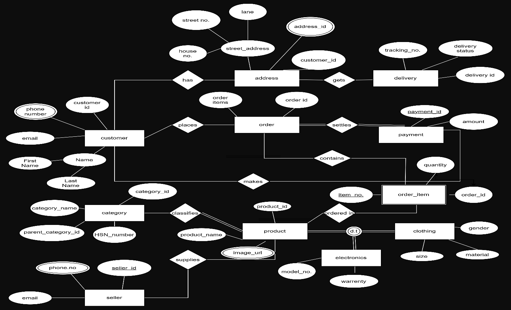

# Experiment 1 — ER Diagram for Indian E-Commerce Platform

## Aim
Design an ER diagram for an Indian e-commerce platform with entities Customer, Product, Order, OrderItem, Seller, Category, Payment, Delivery, Address. Specify primary keys, composite and multi-valued attributes, weak entities, specialization of Product, and participation constraints.

---

## ER Diagram

---

## Entity and Attribute Specifications

### 1. Strong Entities

| Entity | Primary Key | Key & Simple Attributes | Composite Attributes | Multi-Valued Attributes |
| :--- | :--- | :--- | :--- | :--- |
| **Customer** | `customer_id` | `email` | `Name` (`First Name`, `Last Name`) | `phone number` |
| **Address** | `address_id` | `customer_id` | `street_address` (`house no.`, `street no.`, `lane`) | — |
| **Seller** | `seller_id` | `email` | — | `phone.no` |
| **Category** | `category_id` | `category_name`, `parent_category_id`, `HSN_number` | — | — |
| **Order** | `order_id` | `order items` | — | — |
| **Payment** | `payment_id` | `amount` | — | — |
| **Delivery** | `delivery_id` | `tracking_no.`, `delivery status` | — | — |
| **Product** | `product_id` | `product_name` | — | `image_url` |

---

### 2. Weak Entities

- **`order_item`**:
  - **Identifying Owner Entity:** `order`
  - **Identifying Relationship:** `contains` (Order contains Order Items)
  - **Partial Key (Discriminator):** `item_no.`
  - **Other Attributes:** `quantity`, `order_id`

---

### 3. Specialization / Generalization Hierarchy

- **Superclass:** `Product`
- **Subclasses:**
  - **`electronics`**: `model_no.`, `warrenty`
  - **`clothing`**: `gender`, `size`, `material`
- **Constraints:**
  - **Disjointness Constraint:** Disjoint (`d`) — an item cannot be both electronics and clothing simultaneously.
  - **Completeness Constraint:** Total (`t` / double line) — every product must belong to one of the specialized categories.

---

### 4. Relationships and Participation Constraints

- **Customer — Address (`has`):** 1-to-N relationship.
- **Customer — Order (`places`):** 1-to-N relationship.
- **Address — Delivery (`gets`):** 1-to-N relationship.
- **Order — OrderItem (`contains`):** 1-to-N identifying relationship.
- **Order — Payment (`settles`):** 1-to-1 relationship with total participation.
- **Seller — Product (`supplies`):** 1-to-N relationship.
- **Category — Product (`classifies`):** 1-to-N relationship with total participation.
- **Product — OrderItem (`ordered in`):** 1-to-N relationship.
